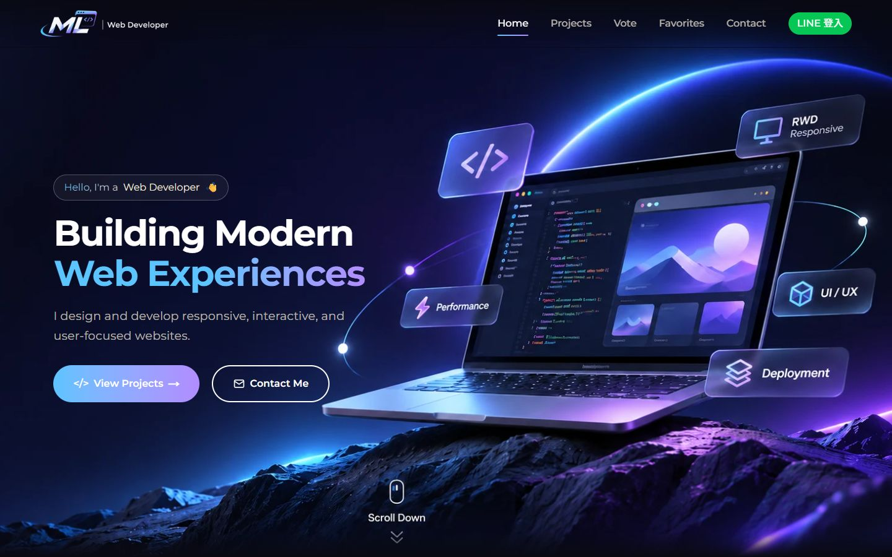
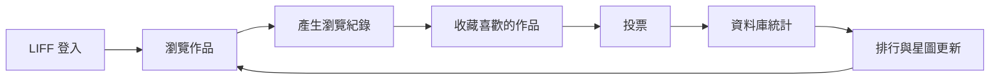
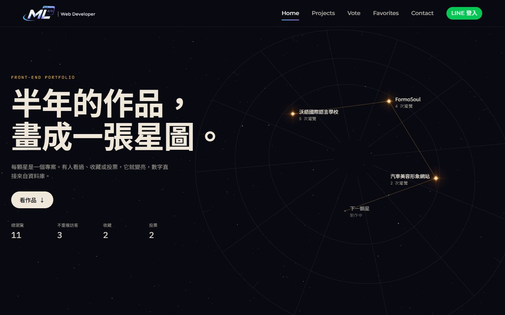
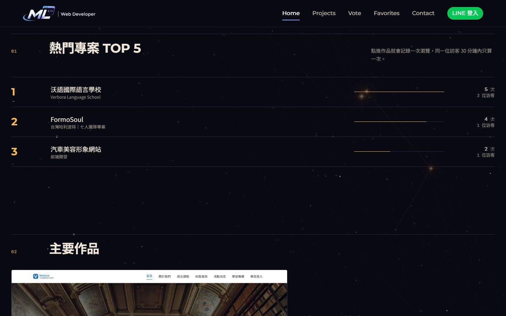
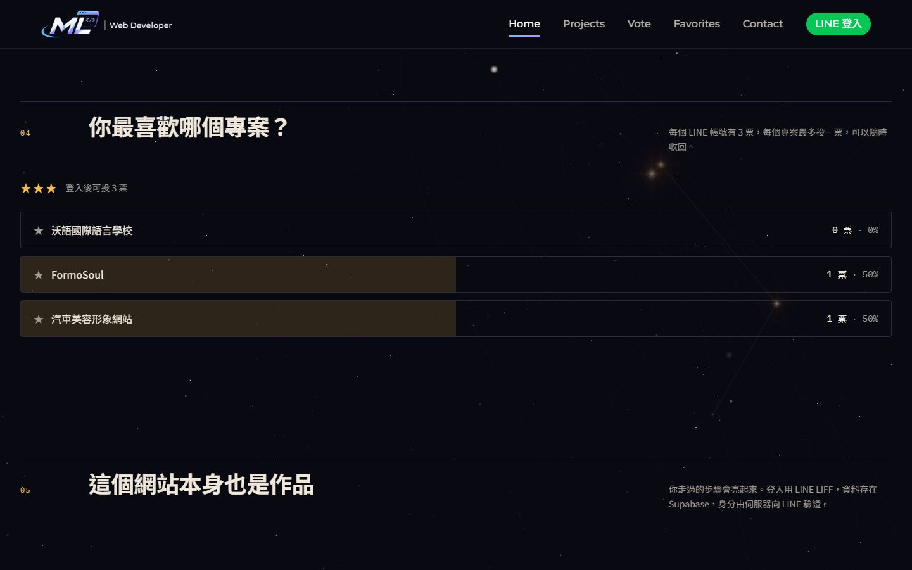
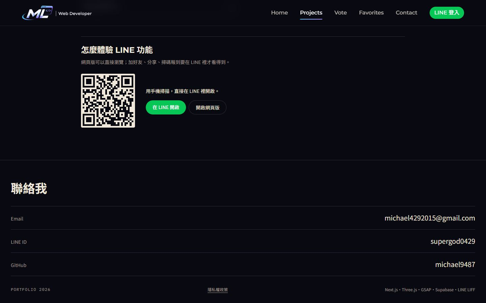
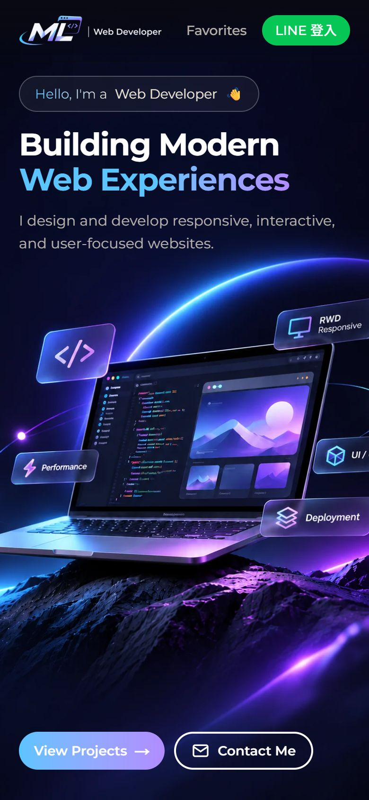

<p align="center">
  
</p>

<p align="center">
  <strong>一個會隨訪客互動而改變的前端作品集</strong><br>
  每個專案是星圖上的一顆星。有人看過、收藏或投票，它就變亮，首頁排行也跟著更新。
</p>

<p align="center">
  
  
  
  
  
  
</p>

<p align="center">
  <a href="https://ml-chen-portfolio.vercel.app/"><strong>線上展示 →</strong></a>
</p>



## 這個作品想展示什麼

作品集通常只是一張靜態清單。我想把它本身也做成一個能操作的全端作品，讓訪客走過一個完整的循環：



## 功能

| 功能 | 說明 |
| --- | --- |
| 瀏覽統計與排行 | 點進作品就記錄瀏覽，首頁自動產生熱門 TOP 5，並統計總瀏覽與不重複訪客 |
| 我的收藏 | 收藏綁定 LINE 帳號，換裝置或下次打開都還在 |
| 專案投票 | 每個 LINE 帳號 3 票，每個專案最多一票，可以收回改投，投完立刻看到結果 |
| 互動星圖 | 用 Three.js 繪製，星星大小直接由資料庫的統計數字決定 |
| LINE 功能入口 | 有 LIFF 功能的專案提供 QR Code，電腦訪客用手機一掃就能體驗 |

| 星圖 | 熱門排行 |
| --- | --- |
|  |  |

| 投票 | LINE 功能入口 |
| --- | --- |
|  |  |

<p align="center">
  
</p>

<sub>畫面中的數字是本機測試資料。</sub>

## 收錄的作品

| 專案 | 內容與負責項目 | 技術 |
| --- | --- | --- |
| [沃語國際語言學校](https://verbora-language-school.vercel.app/) | 以虛構語言學校為題的完整網站，含 LINE 會員登入、加好友、分享、掃碼報到與小型後台 | Next.js、TypeScript、Tailwind CSS、Supabase、LINE LIFF、Google Sheets |
| [FormoSoul](https://tibamef2e.com/tjd103/home) | 七人團隊組長；負責首頁 3D 動畫、最新消息與全部後台頁面 | Vue 3、MySQL、PHP、Element Plus、GSAP、Three.js |
| 汽車美容形象網站 | 前端開發；獨立完成 RWD、JavaScript 互動動畫、SEO 基礎設定與部署 | JavaScript、Netlify |

## 技術選擇

| 技術 | 用途 |
| --- | --- |
| Next.js（App Router）、TypeScript | 頁面與 API，身分驗證和資料存取都放在伺服器端 |
| Three.js | 星圖場景，使用自訂 shader 繪製星光與星塵 |
| GSAP、ScrollTrigger | 進場動畫、捲動浮現、滑鼠視差、數字滾動 |
| Tailwind CSS | 樣式與響應式版面 |
| Supabase（PostgreSQL） | 儲存瀏覽、收藏與投票，統計和票數規則寫在資料庫函式 |
| LINE LIFF | 使用者登入與身分識別 |
| Vercel | 部署 |

## 設計上的考量

**不信任前端傳來的身分。** 前端只會送出 LINE 的 ID Token，由伺服器向 LINE 驗證後才採用其中的使用者 ID，再換成自己簽發的 httpOnly cookie。這樣就無法靠竄改 userId 冒用別人的帳號。

**瀏覽器不直接連資料庫。** 所有資料表都開啟 RLS 且沒有開放任何 policy，資料庫函式只授權給 `service_role`。一切存取都經過 Next.js API，也會檢查專案 ID 是否存在。

**規則放在最接近資料的地方。** 3 票上限寫在 PostgreSQL 函式裡，並用 advisory lock 讓同一帳號的投票排隊，連點或開多個分頁都無法超過上限。

**統計要算得合理。** 同一位訪客 30 分鐘內重複看同一個專案只算一次，重新整理不會灌數字。登入時會把先前的匿名瀏覽併入帳號，同一個人才不會被算成兩位訪客。

**動畫不能犧牲可用性。**

- 開啟「減少動態效果」的使用者會看到靜態畫面。
- 不支援 WebGL 時，星圖會退回純背景，作品連結不受影響。
- 手機只下載直式背景圖，星塵粒子數也會減少。
- 星圖上的標籤是真正的連結，可以用鍵盤操作。

**登入不打斷操作。** 未登入時按收藏或投票，會先記下這個動作，登入導回後自動完成。

## 本機執行

需要 Node.js 20.9 以上。

```bash
git clone https://github.com/michael9487/ml-portfolio.git
cd ml-portfolio
npm install
npm run dev
```

打開 <http://localhost:3000>。不需要任何帳號或金鑰：沒有環境變數時會進入示範模式，資料存在記憶體（重啟就清空），登入使用本機假帳號。

## 部署

### 1. Supabase

建立專案後，到 SQL Editor 執行 [`supabase/schema.sql`](supabase/schema.sql)。

### 2. LINE

在 LINE Developers 建立 LINE Login channel，並新增 LIFF app：

- **Endpoint URL**：部署後的網站網址
- **Scopes**：`openid`、`profile`（缺少 `openid` 就拿不到 ID Token，無法登入）
- **Channel 狀態**：發布為 Published，否則只有開發者與測試者能登入

### 3. 環境變數

照 [`.env.example`](.env.example) 填入 `.env.local` 與 Vercel：

| 變數 | 來源 |
| --- | --- |
| `SUPABASE_URL` | Supabase 的 Project Settings |
| `SUPABASE_SERVICE_ROLE_KEY` | Supabase 的 Project Settings，只能放在伺服器端 |
| `NEXT_PUBLIC_LIFF_ID` | LINE Developers 的 LIFF 頁面 |
| `LINE_CHANNEL_ID` | LINE Login channel 的 Basic settings |
| `SESSION_SECRET` | 自行產生：`openssl rand -base64 32` |

五項都要填。正式環境只要缺一項，互動功能就會關閉，也不會退回示範模式，所以假登入不會出現在線上。

## 專案結構

```text
src/
├─ app/                網頁與 API routes
│  └─ api/             state、views、favorites、votes、auth
├─ components/         畫面元件
│  └─ star-chart/      Three.js 星圖場景
├─ data/
│  ├─ projects.ts      作品資料（新增作品改這裡）
│  └─ site.ts          票數上限、聯絡方式
└─ lib/server/         身分驗證、資料存取、環境設定
supabase/schema.sql    資料表、權限與資料庫函式
```

## 新增作品

在 [`src/data/projects.ts`](src/data/projects.ts) 加一筆資料，星圖、排行、投票和專案頁都會自動出現。
